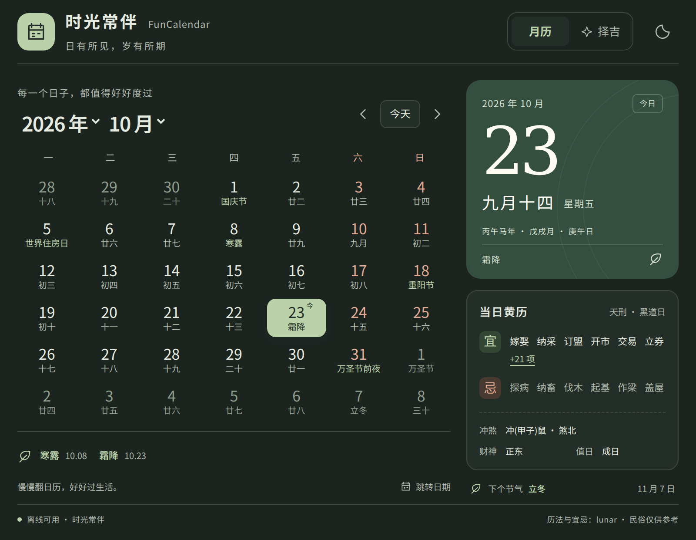

# 时光常伴 FunCalendar

**时光常伴**是一款离线使用的 uTools 双历与黄历插件：一页看阳历、农历、二十四节气和每日宜忌，按嫁娶、搬家、开市等事项查询吉日。松绿色、暖白纸感，日有所见，岁有所期。

Offline Gregorian & Chinese lunar calendar for uTools, with solar terms, traditional almanac and auspicious date filtering.

<p align="center"></p>

[](https://github.com/farfarfun-utools/utools-funcalendar/actions/workflows/ci.yml)
[](https://github.com/farfarfun-utools/utools-funcalendar/actions/workflows/screenshots.yml)

[安装与使用](#开发与安装) · [构建包下载](https://github.com/farfarfun-utools/utools-funcalendar/actions/workflows/ci.yml) · [问题反馈](https://github.com/farfarfun-utools/utools-funcalendar/issues) · [组织插件总览](https://github.com/farfarfun-utools/utools-plugins)

## 功能

- **双历月视图**：阳历与农历同屏，显示闰月、传统节日和二十四节气，支持 1901–2100 年。
- **每日黄历**：查看宜忌、值神、黄道 / 黑道日、冲煞、财神方位与值日；条目较多时可展开全部。
- **按事择吉**：按嫁娶、入宅搬家、开市、出行、动土筛选当月日期，标记可直接点选。
- **快速跳转**：选择年月、日期选择器、返回今天；在 uTools 主输入框输入 `2026-10-23`、`2026/10/23` 或 `2026.10.23`。
- **键盘浏览**：先点击日历，将焦点交给插件，再用方向键选择日期，`PageUp` / `PageDown` 翻月，`Home` / `End` 跳至月初 / 月末。
- **浅色 / 深色 / 跟随系统**：点击右上角主题按钮依次切换。
- **完全离线**：无账号、无接口、无远程字体，运行时不请求外部资源。仅在本机保存主题偏好。

## 界面预览

截图由 GitHub Actions 中的真实 Chromium 自动生成，时间固定为北京时间 2026 年 10 月 23 日。

| 月历 | 按事择吉 |
| --- | --- |
|  |  |



## 宜忌从哪里来

历法与黄历来自 MIT 开源项目 [6tail/lunar-typescript](https://github.com/6tail/lunar-typescript)，当前固定版本 **1.8.6**。每日宜忌使用库内置的 `LunarUtil.DAY_YI_JI` 数据表，以月干支、日干支查询，调用 `getDayYi()` / `getDayJi()` 的默认流派 `sect = 1`。数据随插件打包，无需联网。

两类筛选的含义不同：

- **黄道吉日**：按十二值神的「黄道」分类筛选。
- **具体事项**：该事项出现在当日「宜」，并且未出现在「忌」；不额外要求当天属于黄道日。因此，黑道日也可能显示「宜嫁娶」。

这些内容属于传统民俗，并非官方结论或结果保证。不同历书、流派可能给出不同宜忌；本项目没有独立核实上游数据表对应的传统历书版本。节日标注也不代表法定放假、调休安排。

## 开发与安装

需要 Node.js ≥ 22.22.2，pnpm 版本由 `package.json` 指定。

```bash
pnpm install
pnpm dev          # 浏览器开发预览
pnpm typecheck    # 严格 TypeScript 检查
pnpm test         # 历法逻辑与 Vue 组件交互测试
sh build.sh       # 安装锁定依赖、检查、测试、构建及清单校验
pnpm screenshots  # 构建后生成截图，同时运行浏览器检查
```

在 uTools 开发者工具中创建项目，导入 **`utools/plugin.json`**。输入 `时光常伴`、`日历`、`农历`、`黄历` 或 `FunCalendar` 进入月历；输入 `吉日`、`择吉` 或 `黄道吉日` 进入择吉模式。

CI 也会上传可直接导入开发者工具的 `utools-funcalendar` 构建产物，下载解压后选择其中的 `plugin.json`。

截图需要本机安装 Chrome / Chromium，可用 `CHROME_PATH` 指定可执行文件。截图脚本会检查日期导航、择吉筛选、主题切换、窄屏和横屏布局，并确保没有浏览器错误或外部网络请求。

## GitHub Actions

- **CI**：推送代码与 PR 时执行类型检查、测试、构建，上传插件产物。
- **Screenshots**：推送界面相关代码、打 `v*` 标签或手动触发时，调用组织的[共享截图工作流](https://github.com/farfarfun-utools/.github/blob/master/.github/workflows/screenshots.yml)。生成月历、择吉、深色及窄屏截图；图片有变化时由机器人提交回 `master`。

## 项目结构

```text
src/App.vue              日历、择吉、主题与 uTools 集成
src/lib/calendar.ts      日期边界、双历数据和筛选逻辑
src/style.css            响应式界面与浅深色主题
tests/                   日期逻辑与界面交互测试
scripts/screenshots.mjs  截图与浏览器检查
scripts/cdp.mjs          复用现有插件的 Chromium CDP 工具
utools/                  插件清单、图标和构建产物
```

属于 [farfarfun-utools](https://github.com/farfarfun-utools) 插件产品线，沿用 Vue 3 + Vite 技术栈。

[MIT License](LICENSE)
